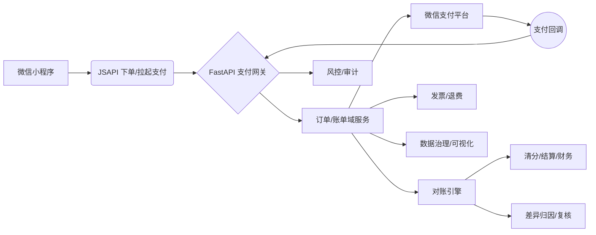
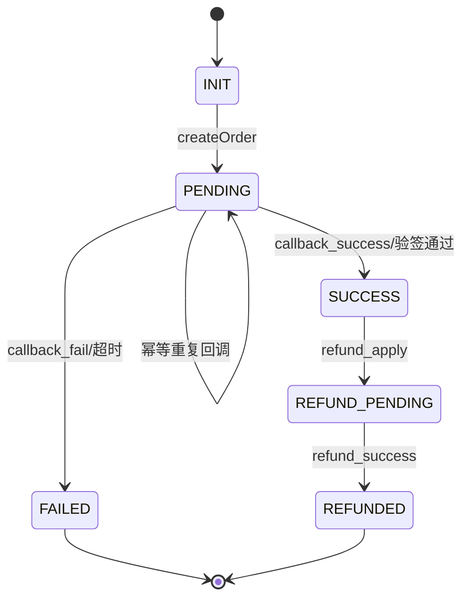

项目题目：智慧校园之学费支付革新：小程序在线支付平台的搭建与实践

[选题依据]  国内外相关研究的学术史梳理及研究动态（略写）；本课题相对于已有研究的独到学术价值和应用价值等。
一、研究背景与现状梳理（略写）
（一）国际国内智慧校园与移动支付融合趋势  
1. 智慧校园从“信息化”走向“数据驱动”的演进中，校园缴费场景因其高频、刚需、广覆盖，成为重要的数字化入口。国际上，围绕移动支付在教育支付（tuition payment）中的应用，研究聚焦于用户接受模型（TAM/UTAUT）、支付安全合规（PCI DSS、数据最小化）、交易可靠性与可用性工程（APM/可观测性）。  
2. 国内方面，微信支付、银联云闪付、支付宝等移动支付体系逐步渗透校园财务管理，研究热点集中在：统一身份与账户绑定、对账与清分的金融级可靠性、接口标准化、支付安全（签名验签、密钥管理、风控拦截）、以及与教务/财务系统的深度集成。行业实践以“平台型+场景化”模式为主，即在一个统一小程序/门户内承载学费、杂费、宿舍水电、教材等多类缴费场景，并通过API网关与后端微服务/模块化系统耦合。

（二）痛点与挑战  
1. 业务侧痛点：传统窗口缴费效率低、排队拥堵；多渠道分散导致核对困难；账务、开票、退费流程割裂。  
2. 技术侧痛点：高并发缴费时段的可靠性与幂等性控制；支付通知异步一致性与对账闭环；隐私保护与合规要求日益提升；与学校财务/学籍/资产系统的对接复杂度高，存量系统异构。

二、本课题的定位与价值  
（一）学术价值  
1. 将“平台工程（Platform Engineering）+教育场景支付”进行系统化方法论凝练：从身份绑定、账单生成、统一清分到对账、风控、可观测性，形成可复用的技术路线与评估指标体系。  
2. 在“移动支付可用性与鲁棒性”方面，结合微信JSAPI的异步回调机制与FastAPI的高并发处理，给出校园缴费场景下的可靠性工程实践（重试/补偿、消息幂等键、签名验签、对账差异归因）。

（二）应用价值  
1. 构建“微信小程序+JSAPI+FastAPI后端”的统一缴费平台，减少窗口与人工成本，提升缴费体验与结算效率。  
2. 形成与学校财务系统的闭环（账单生成—支付—通知—对账—清分—开票/退费），可复制、可推广至其他费用场景。  
3. 提升数据治理能力：实现缴费数据可回溯、可审计，为后续学费结构优化、助学政策评估提供数据支撑。

（三）差异化贡献  
1. 面向校园高峰缴费特性设计的高可用与幂等机制；  
2. 以“对账引擎+差异归因模型”为核心的对账闭环方案；  
3. 面向教育合规与隐私保护的“最小必要+分级授权+可审计”策略与实现。


[研究内容]  本课题的研究对象、框架思路、重点难点、主要目标、研究计划及其可行性等。（框架思路要列出研究提纲或目录）
一、研究对象  
（一）对象范围：面向高校学费及相关费用（含宿舍、水电、教材等）的线上缴费全流程；  
（二）参与主体：学生/家长、财务处、教务处、信息中心、支付服务商（微信支付商户）、银行/票据方；  
（三）系统边界：微信小程序端、统一身份与账户绑定、账单生成服务、支付下单与回调处理、对账与清分、发票与退费、风控与审计、数据可视化。

二、框架思路（含研究提纲/目录）  
（总体技术路线：小程序前端 — JSAPI下单与拉起支付 — FastAPI支付网关 — 订单/账单域服务 — 异步回调与幂等 — 对账引擎与清分 — 数据治理与可视化 — 风控与合规）
1. 现状与需求分析：校园缴费流程梳理、角色与权限矩阵、性能与可用性目标。  
2. 体系结构设计：小程序UI/UX与JSAPI流程；后端FastAPI分层、订单/账单域、缓存与幂等键、MySQL持久化、消息队列（可选）。  
3. 安全与合规：密钥管理与签名验签、加密与最小化、日志脱敏与审计、法律法规遵从。  
4. 可靠性工程：限流与弹性、重试/补偿、幂等控制、可观测性。  
5. 核心流程实现：账单生成核验、下单与拉起、回调与状态机、退款与发票。  
6. 对账与清分：多源对账、差异归因、自动化处理、清分策略与结算周期。  
7. 风控与异常：规则与名单、异常告警与处置、应急预案。  
8. 性能与用户研究：QPS/TP99/成功率、A/B测试、行为分析。  
9. 集成与推广：对接财务/教务系统、试点部署与推广、运维与培训。  
10. 评估与成果沉淀：评估模型与指标、技术文档与最佳实践、论文与案例。

三、重点与难点  
（一）重点：  
1. 校园账务闭环：账单-支付-回调-对账-清分-退费/开票全链路；  
2. 可靠性与幂等：多次回调、多次点击、网络抖动下的唯一成交保证；  
3. 对账引擎：多源比对、差异分类、自动化处理率与人为复核界面；  
4. 合规与隐私：密钥、证书、敏感数据分级与脱敏审计；  
5. 与存量系统集成：标准化API与适配层，降低耦合与改造成本。  
（二）难点：  
1. 高峰并发下的系统稳定性与回调风暴处理；  
2. 异步一致性与最终一致性下的业务可解释性；  
3. 跨部门流程协同与权限边界；  
4. 退款、异常订单、跨日对账的复杂情形处理。

四、主要目标（量化）  
（一）业务目标：线上化率≥95%；对账准确率≥99.99%；差异自动归因覆盖≥90%；异常闭环≤T+1；用户满意度≥90分。  
（二）技术目标：高峰≥1000 QPS（可按校情调整）、支付成功率≥99.9%、TP99≤2s；回调幂等率100%；敏感数据100%脱敏；关键链路可观测性覆盖≥95%。

五、研究计划及可行性  
（一）时间安排（2025年）：  
1. Q1：调研与需求冻结；架构评审；原型优化；测试与评估指标设计。  
2. Q2：核心功能完善（账单、下单、回调、对账v1、幂等/风控）；联调与试点。  
3. Q3：全量覆盖（退费、发票、清分、运维可视化）；压测与稳定性治理；校园推广。  
4. Q4：成效评估与优化；论文与白皮书；软著/专利；结题材料。  
（二）人员与分工：负责人、前端、后端、运维测试、集成财务协同。  
（三）可行性：技术成熟（小程序+FastAPI已完成）、资源保障、风险可控、评估可量化。

（扩展专章A）对账引擎设计与实现（重点）  
一、总体目标与输入输出  
（一）目标：实现多源数据一致性校验、差异自动化归因与闭环处理，保证财务对账准确可追溯。  
（二）输入：微信支付对账单（API v3）、内部订单与支付明细、银行结算流水（若有）。  
（三）输出：对账差异清单、差异归因类别、自动处理结果与人工复核任务、结算与清分报表。

二、处理流程与组件  
（一）对账单采集：定时任务在T+1下载并存储对账单；异常自动重试与告警。  
（二）解析标准化：统一映射为内部对账模型（字段统一、时间与时区归一）。  
（三）比对规则：按“商户订单号/支付单号/金额/状态/时间窗口”进行主键与属性对齐；支持容差（如分/秒级误差）。  
（四）差异归因：  
1. 时序不同步（支付成功未回写/延迟）；  
2. 金额差异（币种/金额精度/折扣）；  
3. 重复回调/重复记账；  
4. 退款滞后/跨日；  
5. 对账单缺失或格式异常；  
6. 人工干预导致状态偏差。  
（五）自动化处理：  
1. 可回滚补写（幂等更新）；  
2. 触发补偿流程（推送重试/补偿状态机）；  
3. 标记人工复核并生成任务单；  
4. 规则引擎可配置（DSL/策略表）。  
（六）审计与报表：生成差异日报/周报，关键字段签名留痕，支持追溯。

三、性能与可靠性  
（一）存储与索引：对账中间表与差异表分库分表（按账期/院系）；关键字段索引优化。  
（二）扩展性：对账任务并行分片处理；幂等键与去重；断点续跑。  
（三）可观测性：对账任务成功率、差异率、自动化处理覆盖率、复核时效指标全量上报。

（扩展专章B）合规与隐私保护条款（重点）  
一、合规框架与适用范围  
（一）法律法规：数据安全法、个人信息保护法等；参照PCI DSS理念进行交易类敏感数据保护。  
（二）最小必要：仅采集与支付处理相关的最少字段；设置数据保留与删除策略。  
（三）分级授权：按岗位最小权限；敏感操作双人复核与审计。  
（四）跨境与外部共享：严格审批与脱敏，默认不出域。

二、关键技术控制  
（一）密钥管理：API v3密钥、平台证书、商户私钥安全存储（HSM或系统密钥库）；定期轮换；权限隔离。  
（二）传输与存储：TLS1.2+；敏感字段加密存储；日志脱敏（屏蔽卡号/证件号/手机号等）。  
（三）签名验签：严格遵循微信支付API v3规范；请求/回调均进行验签与重放防护（时间戳+Nonce）。  
（四）审计与留痕：对关键操作、对账修正、退款审批全链路审计；审计日志防篡改与保留期管理。  
（五）数据主体权利：查询、更正、删除（在法规允许边界内）流程可执行，响应时限可量化。

（扩展专章C）指标体系与评估方法（重点）  
一、核心SLO/SLI  
（一）可用性类：支付成功率、系统可用性（按月/学期）、TP99延迟、峰值QPS。  
（二）对账类：对账准确率、对账差异率、自动化归因覆盖率、复核闭环时效（T+1/小时级）。  
（三）风控与合规：异常拦截率、误拦截率、审计覆盖率、敏感数据暴露为0。  
（四）体验类：用户操作步数、支付完成时长、满意度（问卷）。

二、评估方法  
（一）实验设计：高峰周与非高峰周分层对比；A/B方案；灰度发布。  
（二）数据采集：埋点+日志+指标三栈；统一观测平台汇总。  
（三）统计分析：显著性检验、置信区间、分层回归；异常值处理与归因。  
（四）复盘改进：以周为单位复盘，滚动优化SLO阈值与策略。

[创新之处]  在学术思想、学术观点、研究方法等方面的特色和创新。
一、学术思想层面  
（一）支付中台化理念：以支付与对账为枢纽，连接学籍、资产、票据与统计服务，形成可复用平台能力。  
（二）可靠性工程主线：将幂等、补偿事务、可观测性与合规模型系统化引入校园支付研究。

二、学术观点层面  
（一）提出“学费支付闭环度”与“对账自动化覆盖率”两项关键评价指标，量化平台成熟度；  
（二）差异归因分类模型（时序不同步、金额差异、重复回调、退款滞后、对账单缺失等）；  
（三）以用户旅程驱动的小程序交互优化观点，兼顾成功率与感知性能。

三、研究方法层面  
（一）工程+实证结合：真实校园环境A/B与对照实验；  
（二）事件驱动与最终一致性：回调与状态机建模；  
（三）隐私保护设计法：数据最小化、脱敏、分级授权与审计联动。

[预期成果]  成果形式。（略写）  
一、应用与平台：  
1. 校园统一缴费小程序平台一套（账单、支付、对账、清分、退费、发票等）；  
2. 对账引擎与运维面板各一套；  
3. 技术与运维文档、管理员手册、培训课件。  
二、论文与报告：  
1. 研究论文1-2篇；  
2. 白皮书/研究报告1份；  
3. 软件著作权/专利各1项（视进展）。  
三、指标达成：达到[研究内容-主要目标]预设阈值。

[参考文献]  开展本课题研究的主要中外参考文献。（略写）  
[英文]  
1. Davis, F. D. (1989). MIS Quarterly.  
2. Venkatesh, V. et al. (2003). MIS Quarterly.  
3. Newman, S. (2015). Building Microservices. O’Reilly.  
4. Bass, L., Weber, I., & Zhu, L. (2015). DevOps: A Software Architect’s Perspective. Addison-Wesley.  
5. PCI Security Standards Council. PCI DSS v4.0 Standard.  
6. Fielding, R. (2000). REST Architectural Styles.  
[中文/资料]  
7. 微信支付开发者文档：API v3、JSAPI、对账单（https://pay.weixin.qq.com/wiki/doc）。  
8. FastAPI 文档（https://fastapi.tiangolo.com/）。  
9. 教育信息化与智慧校园综述（近五年期刊）。  
10. 数据安全法、个人信息保护法配套指南。  
11. 可观测性与APM实践相关白皮书。


（附：图示Mermaid源码，可用于导出为图片后插入docx）

【技术路线图】


【对账流程图】
```mermaid
flowchart LR
  A[下载对账单 T+1] --> B[解析与标准化]
  B --> C{多源比对\n(订单/支付/银行)}
  C -->|一致| D[标记通过]
  C -->|不一致| E{差异分类}
  E --> E1[时序不同步]
  E --> E2[金额差异]
  E --> E3[重复回调]
  E --> E4[退款滞后]
  E --> E5[单据缺失]
  E1 --> F[自动补写/重试]
  E2 --> F
  E3 --> F
  E4 --> F
  E5 --> G[人工复核任务]
  F --> H[生成差异报告]
  G --> H
  H --> I[清分/结算出具]
```

【订单状态机】


